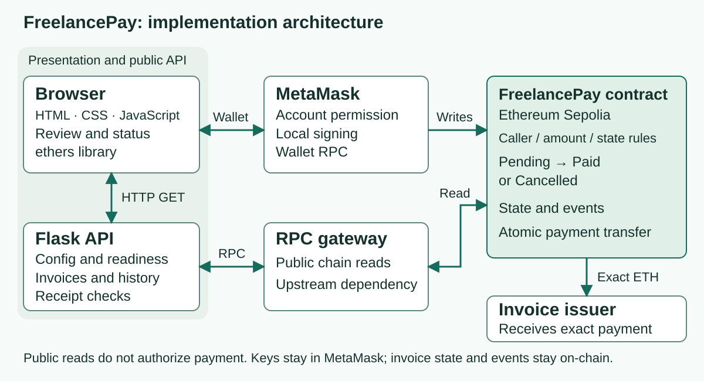
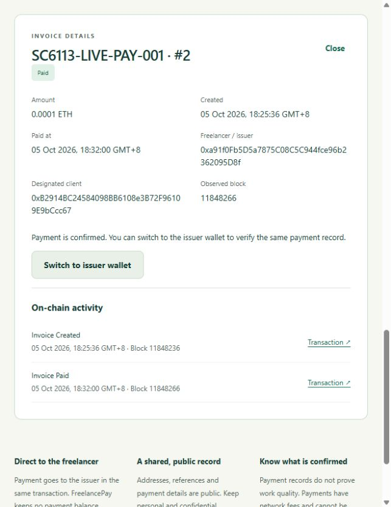

<!-- PAGE 1 -->
# FreelancePay
## SC6113 Individual Assignment

**Implementation and evaluation report - public submission v4.** Live evaluation: 5 October 2026. The public Sepolia workflow is deployed on Render. Actual hosted creation, exact-value payment and unpaid cancellation are corroborated by receipts, state, events and ordinary Chrome observations.

## 1. Introduction

FreelancePay is an educational invoice-payment DApp for a freelancer and a designated client. An issuer creates a request, the client pays its exact test ETH amount, and both parties can inspect a shared on-chain record. Ethereum Sepolia is used throughout the public demonstration; this is not a production payment service.

The application combines a Solidity contract, MetaMask, an English browser interface and a Python Flask backend. The contract enforces payment rules. Flask serves public chain reads without a user signing key. The deployed site supports actual Chrome/MetaMask payment and cancellation, with separate browser and chain evidence [E7].

## 2. Problem Statement

Consider a small freelance engagement: the parties need to associate a payment with a specific request, establish who can pay it and agree whether it is unpaid, paid or cancelled. Separate messages and payment notifications can leave that association unclear. This is the project's design scenario; no interviews or market-demand statistics were collected.

Blockchain provides a common verifiable settlement record and contract-enforced rules. It does not determine whether work was completed correctly, identify the people behind addresses or necessarily reduce payment costs. Those boundaries are part of the design.

## 3. Objectives

| Objective | Observable acceptance |
|---|---|
| Make payment intent clear | Review reference, parties, exact amount, network and status before signing. |
| Enforce payment rules | Only the designated client pays a Pending invoice; value must match exactly. |
| Complete settlement | Transfer the requested value to the issuer and record Paid atomically. |
| Make results inspectable | Reconstruct receipt-backed status and activity from chain data. |
| Integrate the full stack | Browser views use real Flask APIs and the verified public contract. |
| Evaluate the implementation | Record security, usability, gas and latency evidence with explicit scope. |

These six project targets support the assignment's five learning objectives: blockchain fundamentals (L01), Solidity design (L02), full-stack integration (L03), evaluation (L04) and practical DeFi (L05). The contribution is a bounded freelancer workflow, without tokens, escrow or disputes. Development used Codex assistance; evidence and limitations require student review before submission.

<!-- PAGE 2 -->
## 4. System Architecture

MetaMask signs locally and broadcasts a transaction. Validators and execution clients check the instructions, execute contract bytecode in the EVM and validate block inclusion. Nodes replicate the resulting state; receipts and events describe execution [7]. Submission alone does not establish success.

The browser requests wallet permission and signing separately from Flask reads. Flask serves configuration and reads invoices, receipts and history through an RPC gateway, checking chain and deployed-runtime identity. It cannot sign for a user or authorize payment. The contract enforces the shared settlement rules.

**Figure 1.** Wallet-signed writes reach Sepolia; Flask provides public reads. Successful payment forwards the exact invoice value to its issuer. The actual Render deployment is evidenced separately [E7].

Ethereum stores authoritative state/events; no database duplicates the ledger. Browser storage retains nonsecret pending hashes, a disconnect preference and a per-tab public account preference. Only a currently authorized address can be selected. Storage grants no permission; a Flask query address does not authenticate its owner.

## 5. Technologies Used

| Technology | Implemented responsibility |
|---|---|
| Solidity 0.8.30 | Contract rules, invoice storage, events and exact-value transfer. Optimizer: 200 runs; EVM target: Paris. |
| Ethereum Sepolia | Public application test network, chain ID 11155111; test funds only. |
| MetaMask and ethers 6.17.0 | Provider/account/network handling, wallet signing, integer units and receipts [2,3]. |
| HTML, CSS and JavaScript | English role views, reviews, feedback and responsive presentation. |
| Python 3.12.14, Flask 3.1.3, web3 7.16.0 | Web service and read-only chain integration. |
| Anvil and automated checks | Disposable local EVM, API tests and isolated browser fixtures. |
| Render and Gunicorn 26.2.0 | Verified Linux hosting with the production entry point [4,5,E7]. |

Production is configured for `gunicorn --config gunicorn.conf.py wsgi:app`; Flask's development server is local only. Pinned dependencies and the vendored ethers license preserve versions and attribution.

<!-- PAGE 3 -->
## 6. Smart Contract Design

One persistent FreelancePay contract stores many invoices. Each invoice has an issuer, designated client, integer amount in wei, public reference, creation/settlement timestamps and blocks, and a status. Details are fixed after creation. A correction requires cancelling an unpaid request and issuing a new one.

| Action | Caller and validation | Result |
|---|---|---|
| createInvoice | Caller becomes issuer. Client is nonzero and different; amount is positive; reference is 1-32 printable ASCII bytes without edge spaces. | New Pending invoice and InvoiceCreated event. |
| payInvoice | Existing Pending invoice; msg.sender is its client; msg.value equals amountWei. | Direct issuer transfer, Paid state and InvoicePaid event. |
| cancelInvoice | Existing Pending invoice; msg.sender is its issuer. | Cancelled state and InvoiceCancelled event; no payment or refund. |
| Public reads | Existing ID; nonzero query address; page size 1-50. | Invoice data or bounded newest-first role IDs. |

**State model:** Pending may become Paid or Cancelled. Both are terminal. The contract rejects a second payment, a wrong actor, an incorrect value, an unknown ID or cancellation of a terminal invoice. These restrictions apply even if a caller bypasses the frontend.

Payment follows checks-effects-interactions: validate the caller, state and value; write settlement state; then call the issuer with the exact value [1]. A shared nonReentrant guard covers all three state-changing functions. If the issuer rejects the transfer, the transaction reverts, rolling back state and events. This prevents a false Paid record; it also means an issuer contract that always rejects ETH cannot be paid through this workflow.

There is no escrow or withdrawal workflow. An eligible payment is forwarded in the same transaction. The contract provides no mechanism to recover unrelated ETH forced into its balance. Storage mappings and bounded role-page reads avoid an unbounded loop in a financial action; gas still depends on storage, input and recipient behavior.

Amounts remain integers. The frontend parses a plain decimal string to wei, rejecting exponent notation, nonpositive values, more than 18 decimal places and uint256 overflow. Address/checksum feedback is checked in the browser; Solidity independently checks binary client identity and payment permissions.

The 37 contract cases cover successful settlement, exact issuer gain, authorization, invalid inputs, terminal states, pagination, independent invoices, recipient failure, rollback and callback attacks [E1]. Passing this internal coverage is not a complete security proof or external audit.

<!-- PAGE 4 -->
## 7. Application Design

The interface organizes invoices into Issued by you and Sent to you. Details show the exact amount, parties, state, on-chain times and activity links. Status filters apply only to the loaded page, with that scope stated beside the control. Actions reflect the selected account and invoice state.

Creation and payment have separate review and wallet-confirmation stages. The authorized-account selector, Disconnect and visible balance refresh expose the current context. The app checks account and chain immediately before a write and invalidates stale reviews. It distinguishes approval, submitted, pending, confirmed, rejected, failed and unknown outcomes. An uncertain hash is retained instead of encouraging another request.

Assessment uses the professor's own desktop Chrome and MetaMask at the HTTPS URL below. It requires neither Codex, the developer's browser profile nor localhost. The README explains two-account setup, exact-value payment, cancellation and recovery.

## 8. Implementation

The frontend discovers the wallet provider and handles account/network events [2]. ethers parses exact integer units and calls the contract [3]. A submitted hash is captured at the wallet boundary before later library reads, so a provider interruption need not lose the recovery reference. The normal path waits for one confirmation; backend recovery accepts a successful mined receipt. Neither establishes protocol finality.

Flask provides public GET APIs for configuration, health, role lists, invoice details, activity and receipts. It checks chain/runtime identity, validates boundaries and sanitizes upstream failures. Explicit public reads have bounded transient-failure recovery; signing is never retried [E9]. `/healthz` checks the configured hosting process; `/api/health` checks chain readiness. History is reconstructed from the recorded creation and settlement blocks. No database or server signing key is used.

**Verified application:** [freelancepay-059m.onrender.com](https://freelancepay-059m.onrender.com)

**Existing Sepolia contract**

`0xF9c9cA735028b3C9787773383D1C6926B9312C0F`

**Contract source SHA-256**

`90bd065854237e43d92a45aac48ded28647d6a222a5003b9f94127175688a33b`

Render runs Python 3.12.14 and Gunicorn 26.2.0 on a separate Free service. The build is `pip install -r requirements.txt`; startup is `gunicorn --config gunicorn.conf.py wsgi:app`. Automatic deployment is Off. The deployed private-repository revision is `8d0c3a626d2d2809ba537701d0c58feb48266070`. Linux logs, HTTPS checks and exact asset/ABI/source identity substantiate deployment [E7].

The contract/ABI remain the original verified deployment [E2]. A server receipt repair supports wallet-routed calls only after this contract emits a recognized event in a successful receipt. Direct calls retain their pending/reverted handling; unrelated and unmined routed transactions are never labelled successful [E8].

<!-- PAGE 5 -->
## 9. Testing and Results

Evidence separates isolated fixtures, actual wallet observations and public-chain reads. Historical dates are retained; unchanged tests are not relabelled as new runs. The final package supplies source, rebuild/test commands, selected screenshots and file hashes.

| Evidence | Recorded result and scope |
|---|---|
| Contract | 37 cases on disposable Anvil; settlement, authorization, rollback and callback attacks. |
| Flask API | 28-case baseline; 32 after receipt repair; now 34 API and 28 transport-recovery cases pass [E9]. |
| Browser and account selection | 31 fixture scenario groups; 14 focused authorized-account checks; 22 input-boundary cases. |
| Actual hosted workflow | #2 created and paid once; separate #3 created and cancelled unpaid; both roles show matching history. |
| Actual recovery | Ordinary Chrome role selection/reload, disconnection, explicit reconnection and balance display observed separately from fixtures. |

**Figure 2.** Ordinary Chrome at the Render HTTPS origin: invoice #2, SC6113-LIVE-PAY-001, is Paid for 0.0001 ETH. The designated client sees both activity entries. Receipts and adjacent-block balances independently corroborate exact settlement [E7].

| Actual Sepolia receipt | Block | Gas used |
|---|---:|---:|
| #2 creation | 11848236 | 297,326 |
| #2 payment | 11848266 | 181,047 |
| #3 creation | 11848283 | 298,115 |
| #3 cancellation | 11848293 | 146,942 |

The issuer gained exactly 100000000000000 wei. The client paid that amount plus a 0.000470033262937182 ETH network fee. Cancellation moved no invoice value: the client balance was unchanged and the issuer paid only its fee. These observed wallet-routed fees are not direct-call gas estimates [E7].

<!-- PAGE 6 -->
## 9. Testing and Results (continued)

Four read-only Sepolia calls against terminal invoices #2 and #3 reject repeated payment and cancellation with InvalidState. No unnecessary failing public transaction was sent. Fourteen final hosted HTTP reads agree on status, role lists, activity and successful receipts; original Paid invoice #1 remains unchanged [E7].

| Measured operation | Samples and observed median |
|---|---|
| Local create | 10 transactions; send-to-receipt 9.453 ms. |
| Local pay / cancel | Five transactions each; 9.964 / 9.009 ms. |
| Public-RPC-backed history read | Five localhost HTTP reads; 2,306.590 ms. |

The earlier study recorded 70 successful HTTP requests: 35 local-chain and 35 public-RPC-backed localhost reads, five per route/environment. Local timings include preflight and immediate mining, excluding wallet approval and public waiting. They are descriptive samples, not Render/load benchmarks or public confirmation durations [E3].

## 10. Challenges Encountered

MetaMask exposing two accounts initially left the issuer selected. An explicit authorized-account selector and role handoff corrected this; fourteen focused checks passed [E6]. Hash capture and account/chain checks addressed stale context and interrupted confirmation paths.

The earlier RPC returned current state but omitted known logs/receipts. Tenderly restored complete canonical history [9,E8]. A wallet-routed creation then exposed recipient-only receipt matching; verifying this contract's successful events recovered #2 without duplicate creation. Four added cases verified that repair [E8].

A later review observed two transient HTTP history failures; the upstream status was not retained. Bounded public-read recovery now permits two extra attempts per API request, honors short Retry-After delays and logs only safe status/method fields. Exhausted, permanent and chain/contract errors remain visible. Fault-injected tests pass; 18 deployed reads and four original receipts were rechecked. This is not an outage guarantee or load benchmark [E9].

Ten selected contrast pairs exceed 4.5:1; desktop and 390px views were inspected. There was no full accessibility or participant study [E3]. Actual other-network switching/recovery (W05/W06) was excluded by the user's Sepolia-only scope and remains unperformed/unverified. Separate simulated guard coverage is retained; the network guard remains active.

## 11. Limitations

Public addresses, references, amounts and events are durable. A private Solidity mapping is not confidential [1]. A wallet proves account control, not legal identity or work quality. Paid and Cancelled are terminal contract states, but mined blocks can be reorganized before finality [8]. The app does not track finalized blocks or implement reorganization recovery. Escrow, disputes and refunds are outside scope.

Free Render sleep/startup limits, public RPC quotas and the wallet/device remain dependencies [6]. Tests and bytecode identity do not prove complete security. Observed fees can exceed a small invoice's value; cost savings are not claimed. No platform fee is charged.

## 12. Future Improvements

Optional authenticated off-chain descriptions could improve context while keeping personal data off-chain. Measured indexing/caching could reduce reads if scale warrants it, with explicit freshness handling. Broader wallet and accessibility studies would extend the limited internal evaluation. These are proposals, not implemented features.

<!-- PAGE 7 -->
## 13. Conclusion

FreelancePay links invoice intent to contract-enforced settlement and a shared record. The bounded freelancer workflow integrates a deployed Flask service, a wallet-signed Sepolia contract and a usable English interface. Results below assess the project's objectives, not predicted rubric scores.

| Project objective | Observed result |
|---|---|
| Clear payment intent | Actual hosted reviews show parties, reference and exact amount before user approval. |
| Enforce payment rules | 37 contract cases and terminal-state read-only calls support role, amount and state restrictions. |
| Complete settlement | Hosted #2 is Paid with exact issuer gain and client amount-plus-fee debit. |
| Inspect results | Both roles reconstruct Paid/Cancelled records, timestamps and receipt-backed activity. |
| Integrate full stack | Real HTTPS, Linux/Gunicorn, public-chain reads and hosted MetaMask journeys are verified. |
| Evaluate implementation | Scoped security/usability, gas and latency evidence is recorded with fixture/live distinctions and explicit limitations. |

The contribution is a coherent invoice workflow with exact-value transfer, terminal states and recoverable transaction evidence. It does not establish production readiness or eliminate hosting, provider or wallet trust. The [public submission repository](https://github.com/hoonjang98-rgb/6113-individual-assignment-submission) provides the v4 source, report, dated evidence and reproduction instructions. Privacy edits do not change the measured results.

**Evidence locators.** Under `docs/evidence/`: [E1] contract-tests.xml, api-tests.xml, browser-tests.json and input-boundary-tests.json; [E2] sepolia-deployment.json, sepolia-invoice-creation.json and sepolia-invoice-payment.json; [E3] performance-evaluation.json and application-review.json; [E4] compliance-audit.json; [E5] clean-development-preflight.json; [E6] connected-account-tests.json and chrome-chrome-acceptance.json; [E7] render-live-deployment.json, hosted-payment-verification.json, hosted-complete-chain-http.json and hosted-browser-acceptance.json, with captions in docs/SCREENSHOTS.md; [E8] routed-receipt-repair.json, routed-receipt-api-tests.xml and sepolia-rpc-correction.json. [E9] resilience-repair.json, resilience-live-verification.json and resilience-package-reproduction.json. Records retain distinct dates and environments.

## References

[1] [Solidity: Security Considerations](https://docs.soliditylang.org/en/latest/security-considerations.html).

[2] [MetaMask: Ethereum Provider API](https://docs.metamask.io/metamask-connect/evm/reference/provider-api/).

[3] [Ethers v6: Getting Started](https://docs.ethers.org/v6/getting-started/).

[4] [Flask: Deploying to Production](https://flask.palletsprojects.com/en/stable/deploying/).

[5] [Render: Deploy a Flask App](https://render.com/docs/deploy-flask).

[6] [Render: Deploy for Free](https://render.com/docs/free).

[7] [Ethereum: Transactions](https://ethereum.org/developers/docs/transactions/).

[8] [Ethereum: Proof of Stake and Finality](https://ethereum.org/developers/docs/consensus-mechanisms/pos/#finality).

[9] [Tenderly: RPC Reference](https://docs.tenderly.co/node-rpc/rpc-reference).

Primary references were checked on 4-5 October 2026. They inform the design and constraints; actual success is evidenced separately. Solidity is pinned to 0.8.30; reused ethers code retains its license. Development used Codex assistance, with student review and responsibility for submission.

